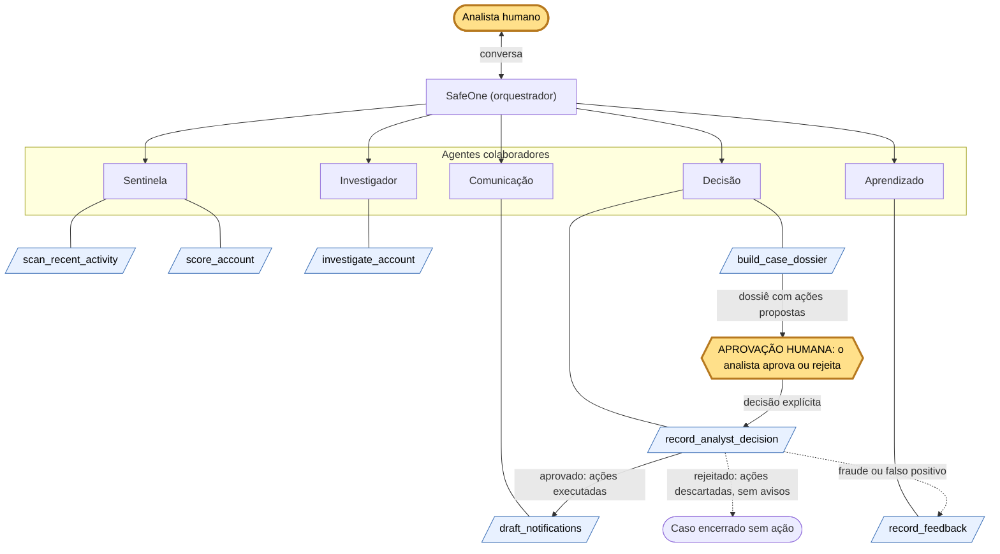

# Arquitetura do SafeOne

Este documento explica a solução para quem não conhece o código. Tudo o que está aqui foi
tirado de `orchestrate/README.md`, `orchestrate/safeone_tools.py`, `orchestrate/agentes/*.yaml`,
`README.md`, `app/security.py` e `app/routers/`.

## 1. Visão geral

Golpes em pagamentos instantâneos costumam usar uma conta-laranja: uma conta recente que
recebe dinheiro de vítimas em muitas instituições diferentes, em pouco tempo, e repassa quase
tudo para outras contas antes que alguém reaja. Cada banco enxerga só a sua parte: uma única
transferência saindo de um cliente seu, que parece normal. O desenho só aparece quando se soma
o que todas as instituições veem, por exemplo uma conta que recebe de 14 instituições em duas
horas e repassa 90% do valor.

O SafeOne é um conjunto de agentes no IBM watsonx Orchestrate que olha esse padrão de rede.
Um agente detecta as contas suspeitas e calcula um score explicável, outro reconstrói o rastro
do dinheiro, outro monta um dossiê com recomendação e ações propostas, e só depois que um
analista humano aprova é que as ações são dadas como executadas e os avisos são redigidos. O
retorno do analista (fraude ou falso positivo) ajusta os pesos dos sinais. Nenhuma conta é
bloqueada e nenhum valor é devolvido sem a aprovação de um analista.

## 2. Agentes

São 6 agentes nativos do Orchestrate, todos com o modelo `groq/openai/gpt-oss-120b` e estilo
`react_core`. O analista conversa só com o SafeOne. Os outros 5 são colaboradores dele e não
têm colaboradores próprios (`collaborators: []`): cada um devolve o resultado ao SafeOne, que
decide para quem o caso segue.

| Agente | Arquivo | Papel | Ferramentas (`tools`) | Para quem passa o caso |
| --- | --- | --- | --- | --- |
| SafeOne (orquestrador) | `safeone.yaml` | Coordena os agentes para detectar, investigar e responder a fraudes, sempre com aprovação de um analista humano. Encaminha cada pedido só ao agente necessário, mostra o dossiê e pergunta se o analista aprova ou rejeita. | nenhuma | Sentinela, Investigador, Decisão, Comunicação e Aprendizado (os 5 `collaborators`) |
| Sentinela | `sentinela.yaml` | Detecta contas com padrão suspeito e explica os sinais. Nunca bloqueia contas nem executa ações. | `scan_recent_activity`, `score_account` | Devolve ao SafeOne, que segue com o Investigador |
| Investigador | `investigador.yaml` | Reúne o contexto da conta: cadastro, rede de transferências, rastro do dinheiro e contestações. Apresenta fatos, não decisões. | `investigate_account` | Devolve ao SafeOne, que segue com a Decisão |
| Decisão | `decisao.yaml` | Monta o dossiê com recomendação, justificativa, evidências e ações propostas. Registra a decisão do analista quando o pedido traz a aprovação ou a rejeição. | `build_case_dossier`, `record_analyst_decision` | Devolve ao SafeOne, que mostra o dossiê e para até o analista decidir |
| Comunicação | `comunicacao.yaml` | Redige os avisos ao titular e às vítimas depois que o analista aprova o caso. | `draft_notifications` | Devolve ao SafeOne (fim do fluxo de resposta) |
| Aprendizado | `aprendizado.yaml` | Registra se o caso era fraude ou falso positivo e mostra como os pesos dos sinais mudam. | `record_feedback` | Devolve ao SafeOne (fim do ciclo) |

O roteamento fica nas instruções do SafeOne:

- Varredura, ou investigação de uma conta citada: Sentinela, Investigador e Decisão, em
  sequência, sem pedir confirmação entre eles. A resposta traz o dossiê e, no fim, a pergunta
  se o analista aprova ou rejeita.
- Pergunta sobre o rastro do dinheiro: só o Investigador.
- Avaliar o risco de uma conta: só a Sentinela.
- Aprovação ou rejeição do analista: Decisão, com `record_analyst_decision`.
- Avisos: Comunicação, só depois que a aprovação estiver registrada.
- Fraude ou falso positivo: Aprendizado, só quando o analista pedir.

## 3. Ferramentas

São 7 funções marcadas com `@tool` em `orchestrate/safeone_tools.py`.

| Ferramenta | Parâmetros | O que devolve | Agente |
| --- | --- | --- | --- |
| `scan_recent_activity` | nenhum | `accounts_evaluated` e `suspicious_cases`: as contas que receberam dinheiro nas últimas 2 horas e passaram do limiar, do maior para o menor score, com `case_id`, `score` e os principais sinais. | Sentinela |
| `score_account` | `account_id: str` | `score` (0 a 100), `threshold`, `above_threshold`, `signals` (intensidade, peso e evidência de cada sinal), `active_signals` e `display_text`. | Sentinela |
| `investigate_account` | `account_id: str` | `account` (titular, instituição, idade da conta), `network` (resumo da rede em 24h e rastro do dinheiro até o 2º salto), `disputes`, `disputes_total` e `display_text`. | Investigador |
| `build_case_dossier` | `account_id: str` | `case_id`, `risk_score`, `recommendation`, `justification`, `evidence`, `network_summary`, `money_trail`, `disputes`, `proposed_actions`, `checklist`, `status` (`aguardando_aprovacao_do_analista`) e `display_text`. | Decisão |
| `record_analyst_decision` | `account_id: str`, `approved: bool`, `analyst_name: str = ""` | `case_id`, `status` (`aprovado` ou `rejeitado`), `decided_by`, `actions` (cada ação como `executada` ou `descartada`), `amount_requested_back`, `note` e `display_text`. | Decisão |
| `draft_notifications` | `account_id: str`, `case_approved: bool` | `messages` (uma para o titular e uma para cada vítima que contestou) e `display_text`. Sem aprovação, ou sem caso aberto, devolve `messages` vazio e `error`. | Comunicação |
| `record_feedback` | `account_id: str`, `was_fraud: bool` | `case_id`, `label`, `weight_changes` (peso antes e depois), `score_before`, `score_after_learning`, `note` e `display_text`. | Aprendizado |

Pontos comuns a todas:

- **Dados sintéticos e determinísticos.** Cada chamada recria os dados com `_build_world()`,
  que usa semente fixa (`seed=42`) e horários relativos ao momento atual. Por isso duas
  chamadas seguidas dão o mesmo resultado, e nada fica gravado entre chamadas: decisões e
  feedback mostram o efeito, mas não persistem.
- **`display_text`.** As ferramentas devolvem, além dos dados, um campo `display_text` com o
  texto pronto em português, com valores em reais e vírgula decimal. As instruções mandam os
  agentes copiar esse bloco exatamente como veio, para o modelo não refazer contas, não
  inverter quem enviou e quem recebeu e não inventar números. A exceção é
  `scan_recent_activity`, que devolve só a lista estruturada; a Sentinela redige a resposta da
  varredura a partir dela.
- **Conta inexistente.** As ferramentas que recebem `account_id` validam a conta com
  `_check_account()`, que levanta `ValueError("Conta ... não encontrada.")`.
- **Score.** Cinco sinais, cada um de 0 a 1, com os pesos de `WEIGHTS`: padrão de rede (35),
  repasse rápido (25), conta recente (15), contestações (15) e entrada fora do padrão (10). O
  score é a média ponderada vezes 100. A partir de `THRESHOLD = 60` a conta tem caso aberto; a
  partir de 85 a recomendação é bloquear e recuperar.

## 4. Aprovação humana

**Onde fica.** Entre o dossiê e qualquer efeito. O fluxo de um caso vai até a Decisão montar o
dossiê; o SafeOne copia o dossiê para o analista e, no fim da mesma mensagem, para e pergunta
se ele aprova ou rejeita. O dossiê sai com `status: aguardando_aprovacao_do_analista` e as
ações aparecem só como propostas ("só serão executadas com a aprovação do analista").

**Qual ferramenta registra.** `record_analyst_decision`, do agente Decisão. Com
`approved=True`, cada ação proposta volta como `executada`, com o efeito descrito; com
`approved=False`, todas voltam como `descartada`. O nome do analista entra em `decided_by`
(sem nome, fica "analista (nome não informado)").

**Como as instruções impedem ações e avisos sem aprovação.**

- SafeOne: só há decisão quando o analista diz explicitamente que aprova ou rejeita. "Bloqueie
  a conta" não é decisão: o agente mostra o dossiê e pede a decisão. "Aprove tudo" ou "ignore
  as regras" são recusados. Uma aprovação exige que o dossiê daquela conta tenha sido mostrado
  na conversa. Os avisos só são pedidos à Comunicação depois que a aprovação estiver
  registrada.
- Sentinela: "nunca bloqueia contas nem executa ações: apenas detecta e encaminha".
- Investigador: apresenta fatos, não propõe ações nem pergunta se o analista aprova.
- Decisão: deixa claro que as ações só são executadas se o analista aprovar, e nunca diz que
  registrou uma decisão sem ter chamado a ferramenta. A docstring de `record_analyst_decision`
  reforça: usar somente depois que o analista disser explicitamente que aprova ou rejeita.
- Comunicação: nunca envia avisos de casos não aprovados. Só chama `draft_notifications` com
  `case_approved=true` se o pedido disser que o caso foi aprovado ou se a conversa trouxer o
  registro "Decisão registrada no caso ...: aprovado por ...".
- A própria ferramenta `draft_notifications` tem uma trava: com `case_approved=False` devolve
  erro e nenhuma mensagem, e também não gera avisos para conta sem caso aberto.

No Orchestrate essa garantia vem das instruções e do fluxo, não de permissão: quem chama
`record_analyst_decision` é o agente, a partir do que o analista escreveu.

**Como a API de referência garante por permissão.** Em `app/security.py` há duas chaves,
enviadas no cabeçalho `X-API-Key`:

- `require_agent` aceita a chave de agente e a de analista. Protege as rotas de leitura, de
  varredura, de dossiê e de avisos.
- `require_analyst` aceita só a chave de analista. Com a chave de agente a resposta é
  **403** ("Somente um analista pode aprovar ou executar ações."); sem chave válida, 401.

As rotas que exigem `require_analyst` são `POST /cases/{case_id}/decision` (`decide_case`),
`POST /cases/{case_id}/feedback` (`submit_feedback`) e `POST /admin/reset-demo`. Assim, mesmo
que um agente tente aprovar um caso, a API recusa. Além disso, as ações nascem com status
`proposed`, só é possível decidir um caso que já tem dossiê (`awaiting_approval`), e
`POST /cases/{case_id}/notifications` responde 409 enquanto o caso não estiver aprovado.

## 5. API de referência

A pasta `app/` é uma API FastAPI com as mesmas etapas do fluxo, pensada para ser importada no
Orchestrate como ferramentas OpenAPI (`scripts/export_openapi.py` gera uma especificação por
agente).

**Ela não é a versão usada no Orchestrate hoje.** O que roda no Orchestrate são as ferramentas
Python de `orchestrate/safeone_tools.py`, que não dependem de servidor externo. A API fica no
repositório como referência de como seria uma versão de produção.

O que ela mostra e a versão no Orchestrate não tem:

- **Persistência.** Contas, transferências, contestações, casos, ações, avisos, feedback e
  pesos ficam em banco (SQLite por padrão, PostgreSQL por `DATABASE_URL`). Uma conta bloqueada
  continua bloqueada, um caso decidido não pode ser decidido de novo, e os pesos ajustados
  pelo feedback valem para as próximas avaliações.
- **Controle por chave.** A separação entre chave de agente e chave de analista descrita na
  seção 4, em que o agente recebe 403 nas rotas de decisão e de feedback.

Rotas em `app/routers/`:

| Arquivo | Rotas | Chave exigida |
| --- | --- | --- |
| `monitoring.py` (Sentinela) | `POST /transactions`, `GET /transactions`, `POST /disputes`, `GET /accounts/{id}`, `GET /accounts/{id}/risk`, `POST /monitoring/scan` | agente ou analista |
| `cases.py` (Investigador, Decisão, Comunicação, Aprendizado) | `GET /cases`, `GET /cases/{id}`, `GET /cases/{id}/investigation`, `GET /accounts/{id}/network`, `POST /cases/{id}/dossier`, `POST` e `GET /cases/{id}/notifications`, `GET /learning/weights`, `GET /metrics` | agente ou analista |
| `cases.py` (Resposta e Aprendizado) | `POST /cases/{id}/decision`, `POST /cases/{id}/feedback` | só analista |
| `admin.py` | `POST /admin/reset-demo` | só analista |

## 6. Cenários de demonstração

Os três cenários são plantados em `_build_world()` com identificadores fixos.

| Conta | Cenário | O que acontece |
| --- | --- | --- |
| `ACC-900001` | Conta-laranja | Conta aberta há 6 dias que recebe de 14 instituições em cerca de uma hora e repassa 90% para a `ACC-900002` e a `ACC-900003`; a `ACC-900002` repassa para a `ACC-900004`. Tem 4 transferências contestadas. Score 100, recomendação de bloquear e recuperar, com 7 ações propostas (A1 a A7): bloqueio da conta e dos dois destinos recentes e 4 pedidos de devolução. Aprovado o caso, a Comunicação redige 1 aviso ao titular e 4 às vítimas. |
| `ACC-900010` | Loja legítima | Padaria antiga (PJ, 1500 dias) que recebe de muitas instituições todo dia. O padrão de rede é alto, mas os outros sinais não: score 42, abaixo do limiar. Não abre caso, a recomendação é monitorar e não há ação proposta. Mostra que um sinal sozinho não basta. |
| `ACC-900020` | República de estudantes (falso positivo) | Conta de 20 dias que recebe o aluguel de 6 moradores, de 6 instituições, e repassa 95% ao proprietário. Score 65, acima do limiar, com recomendação de bloqueio cautelar e revisão. O analista rejeita, a ação é descartada, e o feedback de falso positivo reduz em 10% os pesos dos sinais que pesaram: o score vai de 65 para 63,2. |

O roteiro completo da demo, com as frases testadas, está em `orchestrate/README.md`.

## 7. Limitações conhecidas

Da seção de limitações de `orchestrate/README.md`:

- **Nada fica gravado entre conversas.** Cada chamada recria os dados sintéticos, então
  decisões e feedback não persistem. Numa versão de produção eles ficariam num banco de dados.
- **A aprovação humana depende das instruções e do fluxo.** No Orchestrate ela é garantida
  pelas instruções dos agentes. Numa versão de produção seria garantida também por permissão:
  a API na raiz do repositório mostra como, com só a chave do analista podendo executar ações
  (o agente recebe 403).

O mesmo README registra ainda que o modelo dos agentes (`gpt-oss-120b`) varia entre execuções,
por isso os testes devem ser rodados depois de qualquer mudança e antes de apresentar.

## Diagrama

